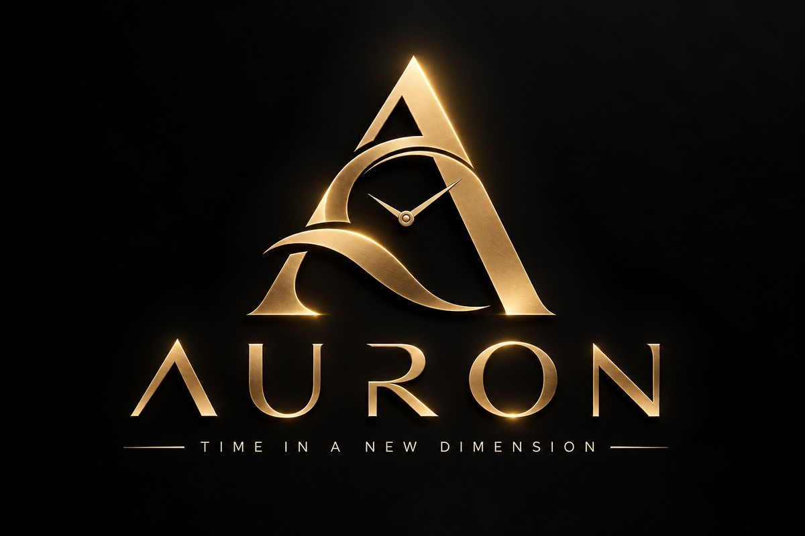
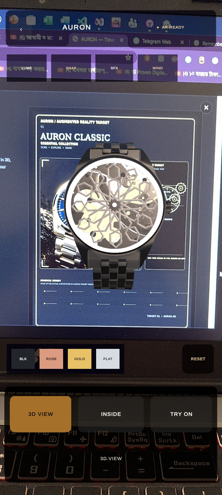
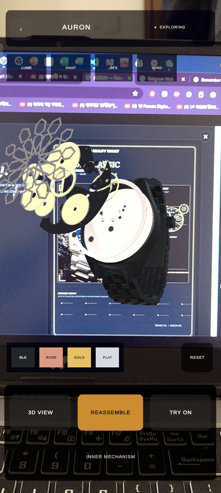
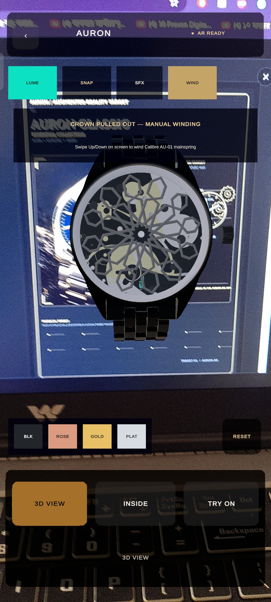
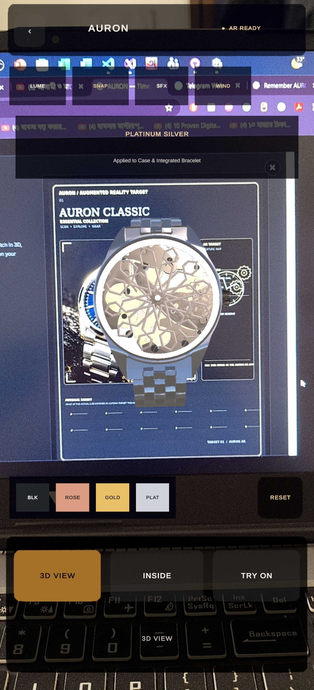
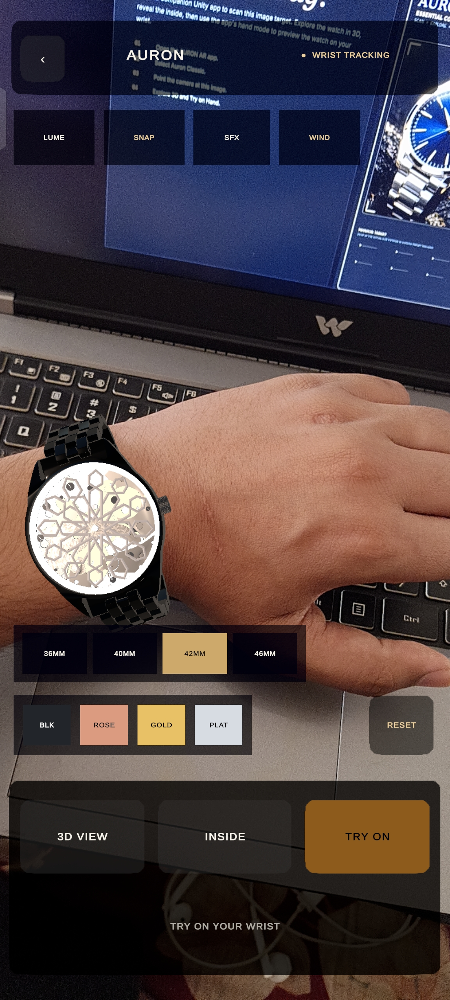
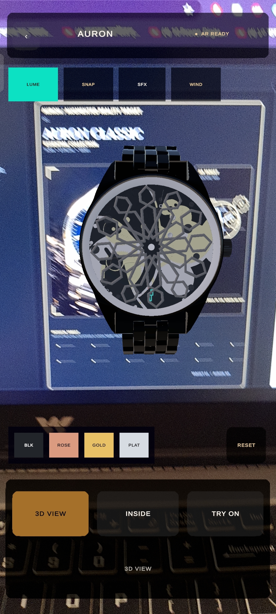
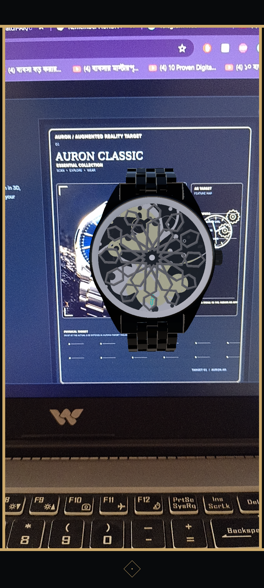
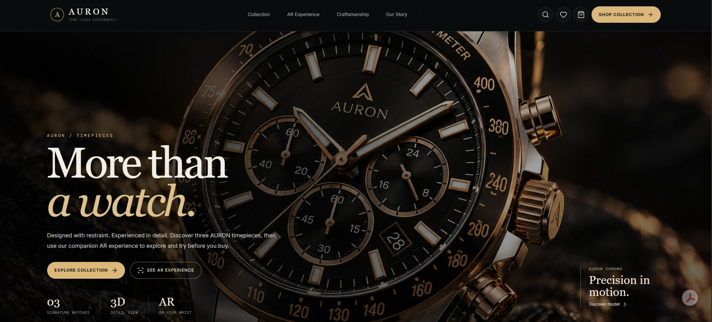

<p align="center">
  
</p>

<h1 align="center">AURON AR Watch ⌚🥽</h1>

<p align="center">
  <strong>Real-Time AI Wrist Try-On &amp; Interactive Luxury Horology AR Experience</strong><br />
  Wear AURON live on your wrist using markerless AI hand tracking. Explore the mechanical calibre, customize precious metal finishes, and capture boutique-edition snapshots.
</p>

<p align="center">
  <a href="https://github.com/mihadkazi1/AURON-Watch-AR/releases">
    
  </a>
  <a href="https://mihadkazi1.github.io/auron-watch-website/">
    
  </a>
  <a href="https://github.com/mihadkazi1/AURON-Watch-AR">
    
  </a>
</p>

<p align="center">
  
  
  
  
  
  
</p>

---

## 🌟 Flagship Highlight: Markerless AI Hand & Wrist Try-On

Unlike traditional AR apps that require wearing a paper wristband or holding a printed QR marker on your arm, **AURON AR** features a **markerless, real-time 3D Wrist Try-On engine** powered by Google MediaPipe and a custom C# 3D pose solver:

- **21-Point 3D Hand & Wrist Landmark Tracking:** Extracts live camera frames from the Vuforia pipeline (`AuronVuforiaCameraFrame.cs`) and feeds them into MediaPipe's `hand_landmarker.bytes` neural network to locate the exact wrist joint (`p0`) and knuckle span (`p5–p17`).
- **6DoF Wrist Pose & Forearm Alignment:** Computes the 3D vector along the forearm, across the wrist, and the dorsal/palm surface normal so the watch case and integrated link bracelet wrap naturally across the user's arm from any angle.
- **Open-Hand & Closed-Fist Continuity (`ScorePlausibleHandOrFist`):** Custom geometric validation rejects background noise and faces while keeping the watch locked onto the wrist even when fingers are curled into a natural closed fist.
- **Live Millimeter Case Sizing (`36MM` • `40MM` • `42MM` • `46MM`):** Dynamically scales the 3D watch relative to the user's real-world wrist width so users can compare how four distinct case diameters fit their arm.
- **Custom Depth-Mask Wrist Occlusion (`AuronWristOccluder.shader`):** Optional depth-buffer masking (`Queue = Geometry-10`, `ColorMask 0`) to occlude back-clasp geometry behind the wrist.

---

## 📖 About AURON AR

**AURON AR** is an Android augmented-reality luxury watch showcase built with **Unity 6.3 LTS, C#, Google MediaPipe Unity Plugin, and Vuforia Engine**. It bridges physical watch retail and digital horology by combining markerless wrist try-on with interactive mechanical inspection, material customization, luminescent night optics, and procedural escapement acoustics.

**Launch → Scan → Explore → Inspect → Customize → Try On Wrist → Capture**

<p align="center">
  <a href="https://mihadkazi1.github.io/auron-watch-website/"><strong>🌐 Visit the AURON Website</strong></a>
  &nbsp; • &nbsp;
  <a href="https://github.com/mihadkazi1/AURON-Watch-AR/releases"><strong>📲 Android APK Releases</strong></a>
</p>

---

## 🖼️ App Screenshots

<p align="center"><em>Selected views from the AURON AR experience</em></p>

<table>
  <tr>
    <td align="center" width="50%">
      <strong>1. Main Watch View</strong><br />
      <br />
      <sub>Explore the watch in the interactive 3D view.</sub>
    </td>
    <td align="center" width="50%">
      <strong>2. Exploded Mechanical View</strong><br />
      <br />
      <sub>Separate the watch into its 13 mechanical layers.</sub>
    </td>
  </tr>
  <tr>
    <td align="center" width="50%">
      <strong>3. Gear Inspection</strong><br />
      <br />
      <sub>Tap any floating component to highlight and inspect it.</sub>
    </td>
    <td align="center" width="50%">
      <strong>4. Watch Finishes</strong><br />
      <br />
      <sub>Switch between premium case and bracelet finishes.</sub>
    </td>
  </tr>
  <tr>
    <td align="center" width="50%">
      <strong>5. Live AI Wrist Try-On</strong><br />
      <br />
      <sub>Wear the watch live on your wrist with 36–46 mm sizing.</sub>
    </td>
    <td align="center" width="50%">
      <strong>6. Super-LumiNova™ Night Glow</strong><br />
      <br />
      <sub>Experience the luminescent skeleton dial in low light.</sub>
    </td>
  </tr>
  <tr>
    <td align="center" width="50%">
      <strong>7. Boutique Snapshot</strong><br />
      <br />
      <sub>Capture and save an AURON-framed wrist photo.</sub>
    </td>
    <td align="center" width="50%">
      <strong>8. AURON Website</strong><br />
      <br />
      <sub>Browse the companion website and scan targets.</sub>
    </td>
  </tr>
</table>

---

## ✨ Key Features

### 🖐️ 1. Real-Time AI Wrist Try-On (Core Feature)
- Instant camera-space wrist locking using 21-point MediaPipe hand landmarks.
- **4 Case Size Calibrations:** Switch live between **36MM**, **40MM**, **42MM**, and **46MM** on your wrist.
- Smooth 60 FPS pose interpolation (`positionSmooth = 80`) with zero-lag hand following.
- Works seamlessly with both open hands and closed-fist wristwatch viewing poses.

### ⚙️ 2. Exploded Calibre & Interactive Part Inspection (`INSIDE` Mode)
- Separates the watch into 13 ordered mechanical layers (`Cube.003` skeleton dial down to `Empty.012` sapphire caseback), plus the fluted crown (`Empty.013`) and link bracelet (`Empty.014`).
- **Tap-to-Inspect Horology Callouts:** Tap any floating gear in Inside Mode to highlight it in gold and display its technical specification card (e.g., *60-Second Flying Tourbillon*, *28,800 vph Balance Wheel*, *Twin-Barrel Nivaflex Mainspring*).
- **Synchronized Reassembly:** Smoothly reassembles from backplate to bezel with staggered mechanical locking audio.

### 🕰️ 3. Interactive 3D Exploration, Crown Winding & Auto-Turntable
- Touch/mouse orbit rotation and pinch-to-zoom inspection.
- **Manual Crown Winding (`WIND`):** Pull out the screw-down crown (`Empty.013`) and swipe vertically to wind the mainspring with realistic ratchet clicks while accelerating the internal gear train.
- **Auto-Turntable Showcase:** Enters a 360° showroom turntable rotation after 4.5 seconds of inactivity, and automatically resets to normal `1x` scale and upright pose on touch.

### 🎨 4. Live Precious Metal Customizer & Super-LumiNova™ (`LUME`)
- Swap case and bracelet materials live in both **3D View** and **Wrist Try-On**:
  - **Obsidian Black** (`BLK`) • **18K Rose Gold** (`ROSE`) • **Royal Yellow Gold** (`GOLD`) • **Platinum 950** (`PLAT`)
- **Super-LumiNova™ Night Mode (`LUME`):** Dims studio lighting and activates HDR cyan-emerald emission across the Moroccan geometric skeleton dial and tourbillon cage.

### 📸 5. Boutique Framed Snapshot (`SNAP`) & Procedural Acoustics (`SFX`)
- **Boutique Photo Capture (`SNAP`):** Hides the UI for 1 frame, captures the AR wrist view, composites an obsidian-and-gold **AURON Genève** boutique border with a centered diamond emblem, and saves directly to the Android Gallery (`Pictures/AURON`) via native `MediaStore`.
- **Procedural Horology Audio (`SFX`):** Synthesizes authentic 28,800 vph Swiss lever escapement double-clicks, crown ratchet ticks, and 13-layer reassembly snaps in real time without external audio files.

---

## 📂 Project Structure

```text
AURON-Watch-AR/
├── Assets/
│   ├── scripts/
│   │   ├── AuronTryOnController.cs         # 3D wrist pose solver, 36-46mm sizing & camera-space clone controller
│   │   ├── AuronVuforiaHandLandmarker.cs   # MediaPipe HandLandmarker runner & open-hand/fist geometry validator
│   │   ├── AuronVuforiaCameraFrame.cs      # Extracts live Vuforia camera textures for MediaPipe inference
│   │   ├── AuronWatchExperience.cs         # 3D orbit/zoom, 13-layer explode/reassemble & crown pull mechanics
│   │   ├── AuronLuxuryFeatures.cs          # Material swatches, LUME, SNAP, procedural SFX, WIND & part callouts
│   │   ├── AURONUI.cs                      # Luxury UI canvas builder, mode dock & tracking status header
│   │   └── AuronWristOccluder.shader       # Custom Z-buffer depth mask shader (Geometry-10, ColorMask 0)
│   ├── StreamingAssets/
│   │   ├── hand_landmarker.bytes           # Google MediaPipe Hand Landmarker ML model asset
│   │   └── Vuforia/                        # Vuforia image-target database (.xml / .dat)
│   ├── MediaPipeUnity/                     # MediaPipe Unity Plugin runtime & native bindings
│   ├── Resources/                          # Vuforia configuration & runtime assets
│   └── Scenes/                             # Main AURON AR Unity scene
├── Packages/
│   └── manifest.json                       # Unity 6.3 LTS package dependencies (Vuforia, InputSystem, TMP)
├── ProjectSettings/                        # Graphics, Player, and Android build settings
├── docs/
│   ├── assets/
│   │   └── auron-logo-banner.jpg           # Repository header banner
│   └── screenshots/                        # App & website showcase screenshots (01 to 08)
├── LICENSE                                 # Project license
└── README.md                               # Project documentation
